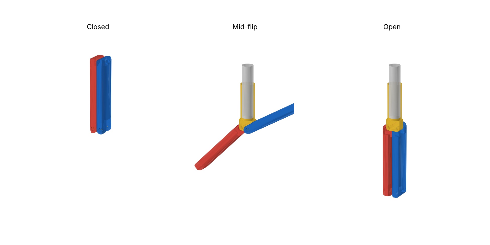

# Clipper balisong holder

A butterfly-knife (balisong) style flip case for a Clipper Classic lighter
(CP11, 74 x 16 mm). Two handles pivot on a carrier that grips the lighter:
closed, they wrap the whole lighter; flipped open, they form a grip and the
lighter stands clear to use.

## Files

| File | Print | Notes |
| --- | --- | --- |
| `stl/carrier.stl` | 1x | Sleeve opening on the bed, tang on top. No supports. |
| `stl/handle_right.stl` | 1x | Back face on the bed, cavity facing up. No supports. |
| `stl/handle_left.stl` | 1x | Mirror of the right handle. |
| `stl/assembly_*.stl` | – | For viewing only, not for printing. |

The STLs are already in print orientation.

## Print settings

- PLA or PETG, 0.2 mm layers, 0.4 mm nozzle
- 4 walls, 20–30 % infill (more walls = more weight = better flipping)
- No supports; the sleeve floor prints as a 16 mm bridge

## Hardware

- 2x M3 x 20 cap-head screws + 2x M3 nuts (nyloc nuts keep the pivot tension)
- Optional: 4x 6 x 3 mm disc magnets, glued into the handle tips so the
  handles snap together closed and open. Check polarity before gluing: each
  pair that meets must attract.

## Assembly

1. Push a nut into the hex pocket of each handle.
2. Slide the carrier tang between the cheeks of each handle and run a screw
   through. Tighten until the handle swings freely without wobble.
3. Flip the handles open and push the lighter into the sleeve.

## Adjusting the fit

Clippers vary slightly and so do printers. Measure your lighter body with
calipers, edit `LIGHTER_D` (and `FIT` if it is too tight or loose) at the top
of `generate.py`, then regenerate:

    pip install manifold3d trimesh numpy matplotlib
    python3 generate.py

The script also sweeps a handle through 0–180° and fails if it would touch
the carrier or the lighter, so parameter changes are checked automatically.
For a Clipper Mini (CP22) set `LIGHTER_D` and `LIGHTER_L` to its size and
shorten `SLEEVE_H`.

The lighter is exposed while lit; keep the flame away from the printed parts.
